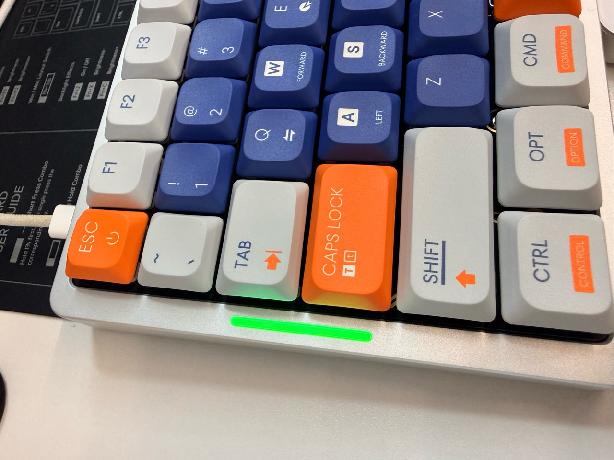
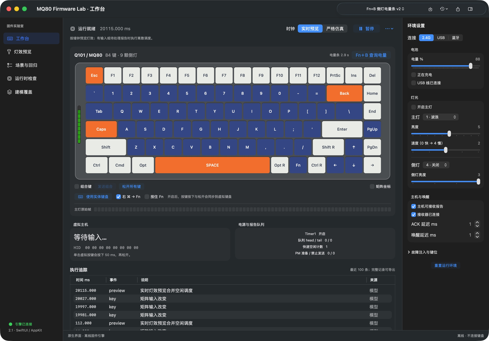

# Q101 / MQ80 · Fn+B 侧灯电量条

把 IQUNIX Q101 / MQ80 的 Fn+B 电量提示改成侧边灯条：**长度表示剩余电量，颜色从红色经过黄色变到绿色，显示约 3 秒后恢复原灯效。** 随项目附带一个原生 macOS 离线固件测试工具。

这是个人学习、研究和自用项目，没有 IQUNIX 或 Telink 官方授权、认证或背书。**修改版固件存在刷写失败、键盘无法启动、无线异常和无法通过 USB 恢复的风险。请先完整阅读本文及[风险与免责声明](DISCLAIMER.md)，再自行决定是否使用。**



*实机照片：本项目使用的 Q101，刷入电量条 v2 后的满电显示。单台设备成功不代表所有批次兼容。*

[下载固件与 macOS App](https://github.com/xiaoliu-heng/q101-mq80-battery-bar/releases/tag/battery-bar-v2) · [测试软件说明](simulator/README.md) · [补丁构建说明](firmware/README.md) · [验证范围](docs/VALIDATION.md)

## 适用范围与已知结果

本补丁基于 **MQ80-CS836B-V0109-20241220** 官方二进制，采用反汇编分析和追加代码的方式修改。厂商完整固件没有在本项目中开源；仓库提供的是本项目新增的补丁源码和测试工具源码。

| 项目 | 当前证据 |
| --- | --- |
| 实测设备 | 一台 IQUNIX Q101 联名款，先刷 MQ80 官方 V0109，再刷本项目 v2 |
| 官方版基准 | 该设备的 USB、2.4G 打字正常 |
| 修改版实测 | 升级工具显示 `OTA Success`；2.4G 正常使用；Fn+B 满电显示绿色 |
| USB、蓝牙、全部电量档位 | 不将官方版的 USB 结果或离线结果当作修改版完整实机验收；修改版仍需逐项验证 |
| 其他 Q101 / MQ80 批次 | 未逐一验证；同名、同外观或相同 VID/PID 都不足以证明兼容 |
| 刷写失败后的强制恢复 | 未证实独立 USB bootloader、强制 DFU 或新程序启动失败后的自动回滚 |

原有 2.4G 相关代码保留，补丁仅修改电量显示相关入口、必要的 RAM 初始化范围、镜像长度和 CRC。这支持代码层面的审查，不能替代真实无线稳定性和续航测试。

## 电量条怎么显示

- 按下 Fn+B 开始显示，松开后继续显示；再次按下会重新计时。
- 使用原固件内部的电量百分比缓存，最大按 100% 处理；没有额外校准 ADC，也没有把曾观察到的 USB 状态字节直接当作电量。
- 9 个逻辑侧灯按比例点亮，最后一段使用部分亮度，不是十次闪灯。
- 颜色连续变化：低电量偏红，50% 黄色，高电量偏绿；100% 全长绿色，0% 全灭。
- 查询时临时覆盖侧灯的关闭状态及连接/充电提示，约 3 秒后交回原固件控制。**原侧灯开启时恢复原灯效，原侧灯关闭时才会熄灭。** 主键区不被电量条代码直接覆盖。

| 电量 | 逻辑长度 | 颜色趋势 |
| --- | --- | --- |
| 10% | 约 0.9 / 9 段 | 红色偏橙 |
| 25% | 约 2.25 / 9 段 | 橙色 |
| 50% | 约 4.5 / 9 段 | 黄色 |
| 75% | 约 6.75 / 9 段 | 黄绿色 |
| 100% | 9 / 9 段 | 绿色 |

长度和颜色表来自代码及离线验证；扩散罩、灯珠差异和人眼感知会影响实物观感。没有亮灯不能单独证明电量为零，也可能是没有触发查询或设备状态异常。

## 下载与校验

在 [Release](https://github.com/xiaoliu-heng/q101-mq80-battery-bar/releases/tag/battery-bar-v2) 的 **Assets** 下载：

| 文件 | 用途 |
| --- | --- |
| `MQ80-CS836B-V0109-20241220-FnB-BatteryBar-v2-EXPERIMENTAL.bin` | 本次分享、已由项目使用者刷入成功的完整 v2 镜像 |
| `MQ80-CS836B-V0109-20241220-STOCK.bin` | 从官方工具提取的 MQ80 V0109 镜像；恢复目标，不是 Q101 原厂完整 Flash 备份 |
| `MQ80-Firmware-Lab-v2.1-native-macOS-arm64.zip` | 原生 macOS 测试 App，含两份镜像，无需另装 Python |
| `SHA256SUMS.txt` | 本次 Release 附件的完整性校验值 |
| `unicorn-2.1.4-source.tar.gz` | App 所用 Unicorn 运行库的对应上游源码，普通使用者无需下载 |

GitHub 自动提供的 `Source code` 压缩包是源码，不是可双击的 App。仓库内两份同内容镜像位于 [`simulator/assets/`](simulator/assets/)，使用短文件名供测试工具加载。

| 镜像 | codesize / 字节数 | Telink CRC |
| --- | ---: | --- |
| 电量条 v2 | **126756** | **068F4D5A**（工具可能省略前导 0，显示 `68F4D5A`） |
| 官方 V0109 | 126292 | B00C451E |

```text
v2 SHA-256
f3e86554be1ed5faf11750fceea85980c9ccd080912be4552e8317fb09ef7719

官方 V0109 SHA-256
d19733978808c856db93236ea3472b2cf843493c9aa6d5320db50412431e5210
```

Windows PowerShell 校验示例（在下载目录执行）：

```powershell
Get-FileHash .\MQ80-CS836B-V0109-20241220-FnB-BatteryBar-v2-EXPERIMENTAL.bin -Algorithm SHA256
```

macOS / Linux 可使用 `shasum -a 256 文件名`，或把所有 Release 附件与清单放在同一目录后运行 `shasum -a 256 -c SHA256SUMS.txt`。**CRC/SHA-256 一致只能证明文件正确，不能证明你的硬件兼容。**

## 使用官方 Windows 工具刷入

以下是供你自行操作的刷写说明。安装或运行本项目测试软件不会刷写键盘。

### 1. 准备官方工具和设备

1. 准备 Windows 电脑、可靠的 USB 数据线、稳定供电，并预留另一把键盘或屏幕键盘。避免升级期间电脑睡眠或断电。
2. 从 [IQUNIX MQ80 VIA 官方页面](https://iqunix.com/blogs/news/mq80-via-guide) 下载对应升级包。本项目分析的是 [MQ80-CS836B-V0109-20241220 官方升级包](https://cdn.shopify.com/s/files/1/0676/7853/5986/files/MQ80-CS836B-V0109-20241220.exe.zip?v=1744019164)。解压后运行 EXE；不要直接运行压缩包内的文件。
3. 该 EXE 大小为 `2580992` 字节，SHA-256 为 `ae26c52d3f4b525870530d7acb387a294b512cae1659038127574dbb7fd1b938`。下面的调试入口只针对这份工具，不推定其他版本相同。仓库不重复托管官方 EXE。
4. 用数据线直接连接键盘，切到 **USB / 有线模式**。本项目设备使用 Fn+5；如果改过键位，请按你自己的配置切换。
5. 本项目键盘的 USB VID:PID 为 `320F:5055`，2.4G 接收器为 `320F:5088`。**此次升级对象是键盘，不是接收器。建议暂时拔下接收器，避免混淆。** 关闭可能占用键盘接口的 VIA 或其他配置工具。
6. 先保存重要 VIA 键位/宏配置。工具未提供经确认的整机固件备份功能；附带的 STOCK.bin 也不包含你的 Q101 联名固件、个人设置或配对信息备份。

### 2. 先建立官方版基准

项目使用者采取的路径是 **Q101 → 官方 MQ80 V0109 → 电量条 v2**。如果尚未确认自己的具体硬件可以使用 MQ80 固件，不要仅凭这个项目的成功案例跨型号升级。

已有适配依据并自行决定升级官方版时，按 [IQUNIX 官方升级步骤](https://iqunix.com/pages/mg-series-firmware-update-steps-guide)操作：有线连接、启动对应工具、点击 Start，等待进度 100% 且显示 `OTA Success`。随后分别确认 USB 和 2.4G 打字正常，再考虑修改版。跨刷后设备可能识别为 MQ80。

### 3. 导入修改版，先核对再开始

1. 保持 USB 模式，打开上述官方工具。
2. 使用菜单 **Get Device Fw Version**，确认能返回设备版本和 CRC。若当前确为对应的官方 V0109，预期 CRC 为 `B00C451E`。若没有回复或版本不符，先停止，排查线材、模式、占用情况或固件版本。
3. 打开 **Debug Mode**，输入小写 **`telink`**，点击 **show Debug surface**。
4. 点击 **open bin**，选择 `MQ80-CS836B-V0109-20241220-FnB-BatteryBar-v2-EXPERIMENTAL.bin`。
5. 必须确认文件路径、`codesize = 126756`、`crc = 068F4D5A / 68F4D5A` 均一致。工具启动时默认加载内嵌官方镜像，不能只看文件名或按钮是否可点。
6. **到这一步只是导入和查询。点击 Start 才会实际刷写。** 如果你只是查看工具或不接受恢复能力未证实的风险，在这里关闭工具即可。

### 4. 刷写与验收

1. 确认愿意承担风险后，点击 **Start**，保持 USB 和供电，不拔线、不切模式、不让电脑休眠。期间键盘可能无法输入。
2. 等待 **进度 100% 且显示 `OTA Success`**；仅到 100% 不等于升级成功。
3. 等设备重新出现，重新执行版本/CRC 查询；修改版预期 CRC 为 `068F4D5A`。若异常，按下面的恢复条件处理。
4. 检查 USB 正常输入，按 Fn+B 查看侧灯，观察约 3 秒后恢复原灯效；测试重复查询、原侧灯关闭时查询和正常按键。
5. 插回接收器，切到 2.4G（本项目设备为 Fn+4），检查输入和 Fn+B。蓝牙、休眠唤醒、长时间使用和低电量表现需要各自验证。

**不要刷入旧 v1（CRC `22F4C08A`）。** v2 修复了显示期限边界问题；本仓库只发布 v2。C / S / ELF、机器码片段、VIA JSON、App 和官方 EXE 都不是要在 `open bin` 中选的完整修改版镜像。

## 出现问题时如何恢复

| 状态 | 能做什么 |
| --- | --- |
| 传输中报错 / CRC 错误 | 结束当前失败会话，保持供电并等待设备退出 OTA；分析到的超时路径约 120 秒，但不保证每种故障都会正常退出。重新连接有线模式后先查版本，有回复才重试 |
| 升级后功能异常，但版本查询有回复 | 使用相同调试入口导入 `STOCK.bin`，核对 `126292 / B00C451E`，再按正常升级流程恢复官方 MQ80 V0109 |
| USB 完全不枚举，或工具始终无回复 | **没有已验证的纯 USB 救砖步骤。** 停止反复尝试，联系厂商；可能需要检查 PCB 后用硬件编程器处理 |

`Stop` 只停止电脑端传输，不会自动恢复官方固件。拔掉 USB 也不一定让带电池的键盘完全断电。不要把 Fn+Esc / 恢复出厂设置当作已证实的强制刷写入口，也不要刷接收器来修复键盘。

离线测试覆盖了 OTA 结束时的数据不足、CRC 错误、头部回读错误及正常完成：错误路径保留旧启动标志，成功后切换镜像。**它不能证明新镜像启动失败后会自动退回旧版，更不能保证任意断电都能恢复。**

当前分享的刷写路径仍是官方 Windows USB 工具。Telink 的 macOS BDT / 硬件编程能力，不等于已经支持这把键盘的私有 USB OTA。本项目 macOS App 也没有刷写功能。

## 附带测试软件：MQ80 Firmware Lab 2.1

一个原生 SwiftUI / AppKit macOS 窗口，通过 Python / Unicorn 执行固件已建模路径的真实 RISC-V / Andes 指令。支持 **Apple Silicon，目标 macOS 13+**；当前仅在一台 macOS 26.5.1 设备验证，未验证 Intel 或所有旧系统版本。已内置官方 V0109 与电量条 v2。



*2.1 原生界面实际截图。右侧电量、连接和充电条件是人为设置的测试输入，不是读取实体键盘。*

| 工作区 | 功能 |
| --- | --- |
| 工作台 | 虚拟 84 键矩阵、实体键盘组合键输入、Fn+B、电量/充电条件、HID 报告和主机字符 |
| 灯效预览 | 执行固件灯效函数，查看主灯和 9 颗侧灯的 RGB 帧、调整亮度和速度 |
| 场景与回归 | 10 个内置场景、JSON 编辑和重放、双固件对比、虚拟 NOR 上的 OTA END / CRC 分支 |
| 运行时检查 | 只读虚拟内存、寄存器、执行统计，保存快照和导出报告 |
| 建模覆盖 | 区分真实代码、模型响应和未实现的硬件边界 |

使用步骤：

1. 从 Release 下载 macOS App ZIP，解压后双击 `MQ80 Firmware Lab 2.1.app`。应用仅做本地 ad-hoc 签名，未做 Apple 公证。若系统阻止首次打开，先核对来源和 SHA-256，再按 macOS 的“隐私与安全性”提示自行决定是否打开；不要全局关闭 Gatekeeper。
2. 顶部选择“Fn+B 侧灯电量条 v2”，调整右侧电量，点击“Fn+B 查询电量”。时钟运行时约 3 个**虚拟秒**后恢复原灯效；暂停会冻结倒计时。
3. 点击“使用实体键盘”（⇧⌘K），直接按组合键。默认右 Command 映射为虚拟 Fn，可按右 Command+B；也可勾选“按住 Fn”再按 B。按 ⌘. 退出输入。
4. “松开所有键”会清空所有虚拟按键；取消“组合键”也会释放。软件只接收本窗口内的普通键盘事件，不使用全局键盘监听。
5. 在“场景与回归”运行全部回归，当前 v2 基准是 10/10；通过 ⌘S 导出报告。⌘O 可导入兼容同一地址布局的应用 `.bin`，不支持任意型号固件或 EXE。

**测试软件不访问或刷写实体键盘。** 它没有完整芯片启动、RF 空口、BLE 控制器、USB 枚举、真实 ADC、电流或 bootloader 模型；部分按键触发灯效和物理 LED 映射仍不完整。离线通过不能证明实物功耗、无线首键必达或救砖能力。

软件源码、构建及操作细节见 [`simulator/README.md`](simulator/README.md)。

## 仓库结构与验证

```text
firmware/           电量条补丁源码、固定版本构建说明、历史离线验证报告
simulator/          原生 macOS 测试软件源码、测试、两份必要镜像
docs/               验证范围、发布核对结果、实机照片和软件截图
scripts/            发布文件完整性检查
third-party/        第三方许可及来源说明
```

本仓库不包含旧实验版本、完整反编译工程、抓包和私人运行日志、工具链、虚拟环境或 build 缓存。App 放在 Release，不放进 Git 历史。

原始记录中固件报告的 `NOT_FLASHED` 表示**当次离线验证没有刷写**，不是当前实机状态；后续使用者刷入成功的证据范围已单独记录在[验证说明](docs/VALIDATION.md)。本次整理没有重新刷写或改变 v2 镜像内容。

## 风险、用途与反馈

**本项目仅作个人学习、研究和自用分享，不作为商业产品、售后方案或安全认证。** 软件、固件、文档均按现状提供；不承诺适用性、稳定性、准确性、售后保修或可恢复性。请阅读[完整风险与免责声明](DISCLAIMER.md)及[第三方说明](third-party/README.md)。用途说明不改变第三方组件的既有许可证，也不能授予厂商固件或商标的权利。

欢迎在 Issues 提交具体型号/批次、固件 SHA-256、连接方式、复现步骤和脱敏日志。请不要上传序列号、个人文件、账号凭证或未经确认可公开的厂商资料。若涉及权利问题，可通过 Issues 提供具体文件和依据，维护者将核查处理。
