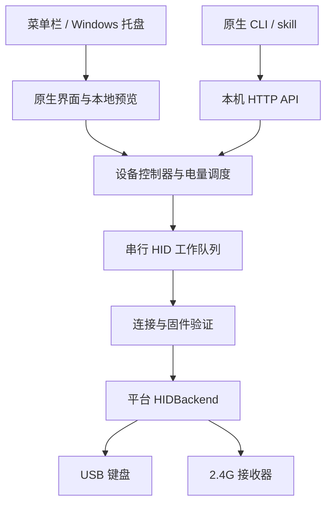

# Kryra 产品与技术设计

版本：Kryra 1.3.0，2026-10-17。本文记录已实现的 macOS 行为，以及 Windows 移植时应保留的接口和约束。Windows 部分是移植设计，尚未实现或进行真机验证。

## 1. 产品目标

Kryra 是 Q101 / MQ80 的常驻桌面控制应用：在菜单栏显示电量，用侧灯发送几秒钟的状态提醒，并向本机程序提供 API 和 CLI。当前仅支持键盘固件 **3.1.0**，连接时同时检查版本、协议和功能位；不兼容未发布的 3.0.1。

默认交互是“调整本机预览 → 发送一次通知 → 键盘自行播放和结束”。动画运行在固件中，电脑不逐帧发送颜色，也不发送控灯心跳。电量是原固件的百分比缓存，不是原始 ADC、实时电流或经过重新校准的剩余容量。

应用不捕获按键，不刷写固件，不通过云服务中转控制。蓝牙控制不在当前范围内。

## 2. 界面与交互

### 2.1 主面板

面板内容固定为 **368 × 584 逻辑点**。macOS 菜单栏弹出面板与独立窗口共用同一份 SwiftUI 内容。窗口标题栏不计入内容尺寸。

| 区域 | 内容与行为 |
| --- | --- |
| 顶部 | Kryra、刷新电量、进入设置；演示模式明确显示“演示” |
| 主视觉 | 左侧连续竖向灯带；右侧电量、连接选择、读数状态、通知状态 |
| 灯效 | 纯色、闪烁、呼吸、彩虹四选一 |
| 颜色 | 纯色类显示预设和原生取色器；彩虹显示渐变说明，占用同样高度 |
| 参数 | 亮度、持续时长、动画周期；纯色隐藏周期控件但保留区域高度 |
| 操作 | “发送提醒”、恢复键盘原灯效 |
| 提示 | 固定 34 点高，最多两行；长错误截断，可查看完整帮助文本 |

灯带是扩散罩中的连续光，不是九个独立可见灯珠。固件的九个 RGB 值是逻辑采样点，预览沿竖直方向插值，使用一个圆头灯带、边缘高光与柔和光晕，不显示格子或间隙。预览仅是示意，不能代替光学测量。

编辑灯效、取色、拖动亮度和修改时长都不会下发灯光命令。点击发送才提交完整参数。预览动画约 20 FPS，只用于当前界面渲染，和 HID 发送频率、键盘物理刷新率无关。系统开启“减少动态效果”时暂停预览动画和按压缩放。

界面默认预览彩虹，亮度 25%，时长 5 秒；预览不表示已经取得灯光控制权。API 发起的本地灯效会同步参数和相位。固件只回复控制状态与剩余时间，不回复真实光学颜色。

### 2.2 设置页

设置页独立显示，不在主面板展开额外区域：

- 设备选择、固件版本、电量更新间隔。
- 本机 API 地址、复制 CLI 命令、打开 API 说明。
- 安装或更新 Codex skill，选择安装父目录。
- 可选登录启动、打开独立窗口、退出。

电量间隔菜单提供 **30 秒、1/2/5/10/30 分钟、1 小时**，默认 1 分钟；API/CLI 可设置 30～3600 的任意整数秒。长路径使用中间截断。主面板和设置页都不使用 `ScrollView`。

### 2.3 原生 Liquid Glass

1.3.0 要求 **macOS SDK 26+** 构建。本次使用 Apple Command Line Tools 26.6 中的 **SDK 26.5 / Swift 6.3.3**，并保留 macOS 13 的部署目标。

在 macOS 26+，按钮和选中的灯效胶囊使用原生 `glassEffect`，同一面板使用一个 `GlassEffectContainer` 组织玻璃控件。内容背景仍使用适合弹出窗口的原生材质；灯带本身保留清晰的颜色。低版本系统使用 Material，减弱透明度时使用实色表面。

固定内容 `frame`、关闭 `NSHostingView` / `NSHostingController` 的自动尺寸推导、固定窗口内容最小/最大尺寸共同保证布局稳定。不要只隐藏滚动条，也不要让错误文本或设置内容决定窗口高度。

界面参考：[Apple 材质规范](https://developer.apple.com/design/human-interface-guidelines/materials)、[自定义视图应用 Liquid Glass](https://developer.apple.com/documentation/SwiftUI/Applying-Liquid-Glass-to-custom-views)。

截图：[浅色主面板](../macos/previews/kryra-v1.3.0-light.png)、[深色主面板](../macos/previews/kryra-v1.3.0-dark.png)、[设置页](../macos/previews/kryra-v1.3.0-settings.png)。截图取自当前 macOS 15.7.4 的兼容外观，带模拟数据；不把它们作为 macOS 26 的玻璃渲染验收。

## 3. 架构与模块边界



UI、API 和 CLI 共用同一个控制器，不各自持有设备句柄。一个专用工作线程串行执行设备枚举、收发和 IOKit RunLoop 回调；UI 线程只更新状态。每个请求匹配命令和序号后才接收回复。

| 模块 | macOS 文件 | Windows 移植边界 |
| --- | --- | --- |
| 应用生命周期、菜单栏 | `macos/Kryra/App.swift` | 原生托盘入口、单实例、退出/睡眠事件 |
| 电量、通知、API 路由状态 | `Controller.swift` | 按同样语义重写控制器 |
| 更新策略与参数校验 | `Polling.swift` | 保留默认值、范围、退避、持久化和重设计时规则 |
| 协议编解码 | `Protocol.swift` | 保留逐字节协议，用相同样本验证 |
| HID 工作线程与设备网关 | `HID.swift` | 平台 HIDBackend 替换 IOKit，保留串行队列和取消检查 |
| 预览数据与控件 | `Presentation.swift` / `Views.swift` / `Glass.swift` | 原生视图替换 SwiftUI；预览不能发送 HID |
| HTTP 解析与监听 | `HTTP.swift` | 保留路由、鉴权、请求大小和并发限制 |
| 运行凭证、skill 安装 | `RuntimeFiles.swift` / `SkillInstaller.swift` | 使用 Windows 用户私有目录与 ACL、Windows 原生 CLI |

## 4. 设备连接与状态

只打开以下 Vendor Defined Raw HID collection：

| 字段 | 值 |
| --- | --- |
| VID | `0x320F` |
| USB 键盘 PID | `0x5055` |
| 2.4G 接收器 PID | `0x5088` |
| Usage Page / Usage | `0xFF60` / `0x61` |

自动选择优先尝试 USB，再尝试接收器。若同一传输类型存在多个候选，要求用户明确选择；不静默控制任意一台。枚举出接收器不等于键盘在线，必须取得有效 INFO 回复，并核对当前键盘连接模式与设备通道一致。

每次新的灯光操作都先发送 INFO，再根据通道权限发送命令。连接验证不只发生在应用启动时，避免切换固件或连接方式后继续使用旧能力。

控制状态包括：未连接、已连接、读数陈旧、电脑休眠、自身通知、外部控制、原灯效。没有可用读数时用空值；断开后保留并标注上次电量，不变成 0%。查询发现外部控制只显示状态，不因查询或退出而自动取得控制权。

## 5. 电量调度与持久化

| 项目 | 已实现规则 |
| --- | --- |
| 默认周期 | 60 秒 |
| 可配置范围 | 30～3600 整数秒；布尔、字符串、小数、越界和未知字段拒绝 |
| 首次启动 | 立即查询一次，之后按间隔等待 |
| 修改间隔 | 保存后取消旧等待，按新策略重新计时，不立即发送 INFO |
| 无设备 | 每 5 秒尝试枚举；无匹配设备时不会发送设备命令 |
| 接收器存在但无回复 | 按配置间隔指数退避，最高 `max(300 秒, 用户间隔)`，不会缩短用户的长间隔 |
| 自身通知有效期间 | 自动电量查询跳过，不为动画额外收发；用户手动刷新仍可主动查询 |
| 电脑休眠 | 停止设备查询；唤醒后刷新电量，不重播通知 |
| 陈旧阈值 | 未连接立即陈旧；已连接读数超过 `2 × 更新间隔 + 5 秒` 标为陈旧 |
| 重启 | 恢复用户的间隔；损坏或非法持久化值回退为 60 秒 |

macOS 存储键为 UserDefaults 的 `batteryPollIntervalSeconds`，与当前选择设备一起保存。API 配置和 token 仍保存于 `~/Library/Application Support/Kryra`。测试使用独立的 `KRYRA_HOME` 与 `KRYRA_DEFAULTS_SUITE`，不修改用户偏好。

自动查询不会取得或续期侧灯控制。控灯前的 INFO、手动刷新和切换设备属于用户触发的额外查询，不受周期限制。降低查询或控灯命令频率不等于已经证明电池续航改善。

## 6. HID 协议

### 6.1 逻辑报告

USB 与 2.4G 接收器使用完全相同的 **32 字节逻辑报告**，不需要应用构造无线物理帧或添加接收器内部头部。

| 请求字节 | 内容 |
| --- | --- |
| 0～2 | `FE 53 4C` |
| 3 | `0x10 OR command`，协议 1 |
| 4 | 8 位序号，递增并允许回绕 |
| 5～31 | 27 字节负载，保留字节填零 |

| command | 用途 |
| --- | --- |
| 0 INFO | 查询状态；不取得控制、不续期 |
| 1 FRAME | 九个 RGB 采样点；高级静态渐变，有限租约 |
| 2 RELEASE | 恢复原灯效 |
| 3 KEEPALIVE | 旧 FRAME 续期；Kryra 不发送它 |
| 4 TIMEOUT | 后续 FRAME 的 500～10000 毫秒租约 |
| 5 PLAY | 固件本地通知 |

回复字节 3 为请求命令加响应位 `0x08`，字节 4 原样返回序号，字节 5 为状态。0 成功；1 协议不支持；2 未知命令；3 参数无效；4 控制过期；5 当前连接不允许；6 长度错误。

关键回复字段：6 协议版本、7 逻辑采样点数量 9、8 控制/Fn+B 标志、9 电量百分比、10 连接（0 蓝牙/1 RF/2 USB）、12 通道权限、13～14 超时、15～16 剩余时间、17～20 ASCII `Q101`、21 输出缩放上限 162、22 功能位。

23～31 的固件元数据为 `46 56 01 03 01 00 flags buildLo buildHi`。当前客户端要求 3.1.0，且字节 22、29 的本地灯效位 `0x10` 均存在。协议序号只匹配当前收发，不承担跨请求去重。

### 6.2 PLAY 负载

以下偏移从 27 字节负载起点计算，所有多字节整数均为小端：

| 偏移 | 内容 |
| --- | --- |
| 0 | 效果 ID：1 纯色、2 闪烁、3 呼吸、4 彩虹 |
| 1 | 亮度 0～100；默认 25 |
| 2～4 | RGB；彩虹必须为零 |
| 5～6 | 周期毫秒：动态 500～20000；纯色为零 |
| 7～8 | 持续毫秒：100～60000；默认 5000 |
| 9～12 | 非零 32 位请求 ID |
| 13～26 | 保留零 |

闪烁半周期亮、半周期灭；呼吸采用往返曲线；彩虹在九个逻辑采样点之间错相。输出仍受固件的 `162/255` 缩放限制，Fn+B 电量条拥有临时显示优先级。

新请求替换旧效果。固件只记住最近一次 PLAY 的 ID 和参数；相同 ID 与参数的重试不会重启或延长通知，已到期或取消后也不会重新播放。相同 ID 搭配不同参数返回错误。重启或使用 FRAME 会破坏该去重记录，不能把它当成永久请求历史。

应用省略 ID 时生成随机非零值。发送超时后可能已经被键盘接受，不自动用新 ID 重试。参数完整地在一次 PLAY 中发送，不建立“逐项修改固件状态”的多帧协议。

### 6.3 超时、取消与休眠

键盘拥有通知截止时间。INFO、KEEPALIVE 和 TIMEOUT 均不能延长本地 PLAY。电脑侧计时只清理 UI，不在到期后补发 RELEASE，避免旧计时器取消更新的通知。

PLAY 不清零原无线空闲计数；键盘原有休眠可以提前结束通知，唤醒不重播，也不能用接口远程唤醒已睡眠的键盘。电脑休眠、切换设备和退出时，应用尝试释放自身取得的控制；纯查询客户端退出不释放其他控制。

高级 `frame` 支持九个颜色样本、0.5～10 秒，无心跳；其旧无线租约仍会保持接收，因此日常提醒优先使用四种 PLAY 效果。显式 RELEASE 没有独立的固件所有者令牌，不能提供多个应用之间的强所有权隔离。

完整协议和固件行为见 [SIDE_HID.md](SIDE_HID.md)。

## 7. 本机 API、CLI 与 skill

服务只绑定 `127.0.0.1` 的动态端口。macOS 私有目录权限 0700，`api.json` 权限 0600；每次启动生成 256 位随机 Bearer token，正常退出删除自己的运行配置。所有路由包括 health 均鉴权；拒绝浏览器 Origin、错误 Host、重复头部、歧义报文和超大请求，并限制并发连接与处理时间。

| 请求 | 用途 |
| --- | --- |
| `GET /v1/health` | 应用、API 版本与 demo 标志 |
| `GET /v1/status` | 完整连接、电量、灯效、设置快照 |
| `GET /v1/battery` | 缓存电量；`?refresh=true` 立即查询 |
| `POST /v1/refresh` | 主动刷新连接与电量 |
| `GET /v1/settings` | 当前设置 |
| `POST /v1/settings` | 保存 `battery_poll_interval_seconds`，不访问 HID |
| `POST /v1/lighting` | 灯效或高级渐变 |
| `POST /v1/lighting/release` | 恢复原灯效 |

```json
{"mode":"breathe","color":"34D399","brightness":25,"period_ms":1000,"duration_seconds":3}
```

```json
{"battery_poll_interval_seconds":60}
```

```sh
kryractl battery --refresh
kryractl settings
kryractl settings --poll-interval 120
kryractl breathe 34D399 --brightness 25 --period 1000 --seconds 3
kryractl release
```

`battery.poll_interval_seconds` 与 `settings.battery_poll_interval_seconds` 表示配置值；实际异常重试可能更慢。`lighting.commands_sent` 是本次灯效命令数，`frames_sent` 是同值字段，均不是键盘动画 FPS。状态是最近回复与本机计时推算，不能提供光学回读。

skill 包含说明和自包含的原生 `scripts/kryractl`，自动读取本机凭证，不要求模型复制 token。安装器只更新自己管理的目录，默认安装到 `~/.agents/skills/kryra`。跨平台版应提供各自的原生 CLI，并保持命令和 JSON 契约一致。

完整用法见 [API.html](../macos/API.html)。

## 8. Windows 移植要点

Windows 版保留协议、状态模型、调度和本机 API，把菜单栏映射为托盘，把 IOKit 替换为 Windows 用户态 HID。UI 技术可独立选择，不把 SwiftUI 材质或像素实现写入协议层。

建议模块为 `TrayHost`、`ControlPanel`、`KeyboardController`、`ProtocolCodec`、`HidWorker`、`WindowsHidBackend`、`LoopbackServer` 和 `NativeCLI`。采用单实例锁，所有来源的命令进入同一工作队列，UI 不同步等待读包。

Windows HID 适配需特别核对：

1. 按 VID/PID 枚举后，再按 `UsagePage/Usage` 过滤 collection，避免打开主键盘输入接口。
2. 读取 `HIDP_CAPS` 的输入、输出报告长度。Windows 缓冲区长度包含 Report ID；无编号报告也使用零 ID。对于本协议，逻辑数据仍为 32 字节，通常对应 `00 + 32 字节数据`；以设备 caps 验证实际长度。
3. 收包适配层按报告描述符移除 ID，再把恰好 32 字节逻辑数据交给公共解析器。不能盲目删除第一个字节，也不能给 RF 路径额外包一层自定义无线头。
4. 等待匹配魔数、协议、命令和序号的响应；超时后让 UI 显示连接状态，取消过期排队任务，不能卡住主线程。
5. 设备拔插、睡眠和句柄错误后关闭旧句柄，重新枚举并进行 INFO 验证，不保留失效权限。

这些缓冲规则依据 Microsoft 的 [HIDP_CAPS 文档](https://learn.microsoft.com/en-us/windows-hardware/drivers/ddi/hidpi/ns-hidpi-_hidp_caps)和[初始化 HID 报告](https://learn.microsoft.com/en-us/windows-hardware/drivers/hid/handling-hid-reports)。Windows 后端仍需真机验证，不能把 macOS 的通过结果当成 Windows 收发确认。

Windows 运行凭证建议存于 `%LOCALAPPDATA%\Kryra\api.json`，用当前用户专属 ACL 保护目录和文件；API 的 loopback/Bearer 策略不变。CLI 在各平台读取对应目录。用户设置独立持久化，升级保留，损坏时使用安全默认值。

UI 沿用上述尺寸与信息层级，以 DIP 排版，覆盖 100%/125%/150%/200% 缩放、深浅色、高对比度和减少动画设置。托盘弹出窗口应按显示器工作区定位，长错误不能撑开布局。平台材质可以更换，连续灯带和操作语义应一致。

## 9. 构建、验证与验收边界

Apple 工具链可以使用系统选中的 Xcode/CLT 26+，或通过 `KRYRA_TOOLCHAIN_DIR` 指向独立的 CommandLineTools 目录。本次工具包来自 Apple Software Update product `140-17812`，校验 Apple 签名、目录中压缩 XAR TOC 摘要和解包数据后使用；未运行系统安装脚本或替换全局开发目录。

```sh
.venv/bin/python macos/build.py --universal
.venv/bin/python scripts/check_macos.py
.venv/bin/python scripts/check_kryra_panel.py
.venv/bin/python macos/tests/validate_app.py --app dist/Kryra.app --out test-results/kryra-app-e2e.json
.venv/bin/python scripts/package_macos.py
```

测试包括真实固件机器码生成的 USB direct / general / RF 协议样本；错误回复与不兼容版本拒绝；通知去重、超时和所有权；可控时钟下的轮询取消、重设、休眠、持久化与读数陈旧判断；真实 loopback HTTP/CLI；浅深色、四模式、设置页、长文本、断线重连、无滚动条和固定尺寸渲染。

Windows 版先复用 `macos/tests/fixtures.py` 生成的样本做协议对照，再做平台收发、DPI、生命周期与安装测试。演示结果必须带 `demo: true`，不可伪装真机数据。

使用者在 2026-10-17 反馈此前 Kryra 真机连接测试正常，原文与范围见 [使用者反馈记录](../macos/hardware-confirmation-20261017.json)。该反馈没有指定连接方式、逐项测试或功耗数据，也不覆盖本次 SDK 26 / 1.3.0 新包。当前开发机仍为 macOS 15.7.4；1.3.0 的原生玻璃 API 已编译，macOS 26 的视觉与交互等待新系统实测。验证结果、包校验值和具体限制记录在 [VALIDATION-v1.3.0.json](../macos/VALIDATION-v1.3.0.json)。
