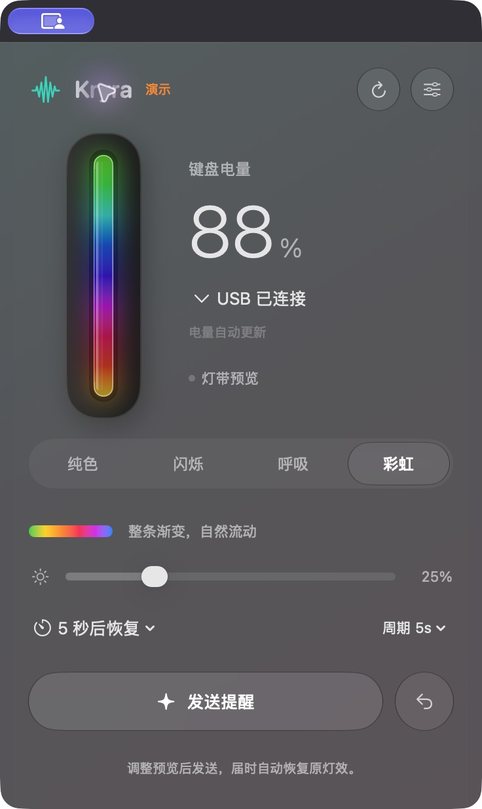
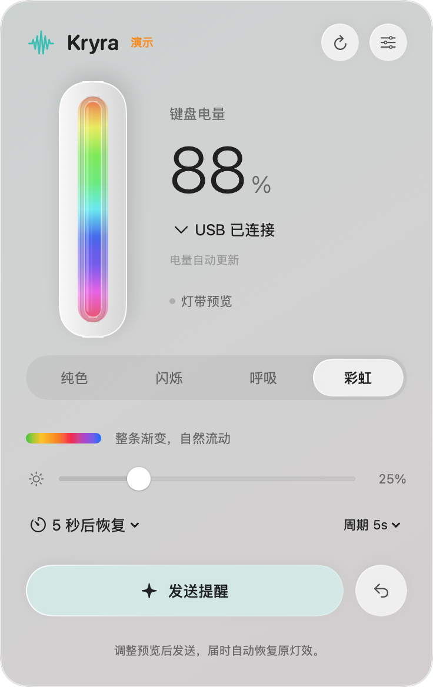
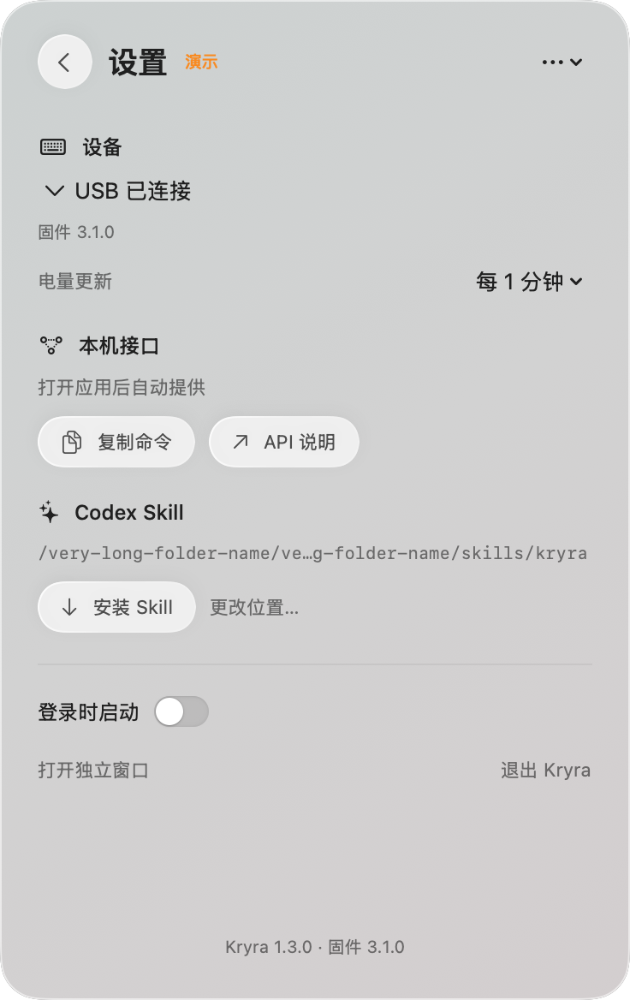

# Kryra

真实键盘的原生 macOS 菜单栏应用。Swift / SwiftUI / AppKit 编写，直接经 IOKit 访问 Q101 / MQ80 的 Raw HID 接口；应用及内附 CLI 都不依赖 Python、网页容器或云端服务。**Kryra v1.3.x 仅支持固件 v3.1.0**，使用其本地通知灯效；连接时检查版本和功能位，3.0.1 及其他版本均提示升级。

1.3.x 使用 **SDK 26.5 / Swift 6.3.3** 构建，在 macOS 26+ 启用原生 Liquid Glass；电量默认每分钟查询，可在设置、API 或 CLI 中配置。使用者已反馈此前版本的真机连接测试正常；[反馈范围](hardware-confirmation-20261017.json)与新包的离线检查分开记录。1.3.4 已在 macOS 27.0.1 的实际独立窗口中检查原生玻璃、四种灯效选择和设置页，未进行功耗测量。

产品交互、状态机、协议、调度和 Windows 移植边界见 [Kryra 设计文档](../docs/KRYRA_DESIGN.md)。

1.3.1 修复菜单栏弹窗的双重圆角与描边。1.3.2 补全独立窗口：保留系统标题栏背景，内容从标题栏下方开始，避免透明标题栏让内容上沿呈现直角。两种容器均由系统负责外部圆角；窗口布局检查与正式应用共用同一创建函数。

1.3.4 恢复等宽铺满面板的玻璃胶囊灯效切换。玻璃直接应用在按钮内容上，使文字由系统绘制在材质之上，避免原先独立背景玻璃层模糊选中文字。1.3.3 测试版改用系统分段选择器后出现的窄蓝色选中项不再保留。继续使用 SDK 26.5 和原生 Liquid Glass，面板保持固定尺寸；本次不修改键盘固件。完整验证范围见 [1.3.4 验证记录](VALIDATION-v1.3.4.json)。

1.3.4 已通过 188 项核心检查、61 项布局检查和 61 项 API/CLI 端到端检查，并完成通用包签名、SDK 和归档校验。实际独立窗口使用隔离演示应用检查，四种选中文字均清晰；本次菜单栏弹窗完成固定布局检查，但电脑控制工具未能绑定其原生弹窗，未补做实际弹窗外观验收。隐藏窗口的位图不作为玻璃效果验收依据。

## 使用

在 [v3.1.0 正式版](https://github.com/xiaoliu-heng/q101-mq80-battery-bar/releases/tag/v3.1.0) 下载 `Kryra-1.3.4-universal.dmg` 或 ZIP。1.3.4 更新 macOS 玻璃控件渲染，继续支持同一固件 3.1.0。

将 `Kryra.app` 放入 `/Applications` 或 `~/Applications` 后打开。首次打开显示控制面板，关闭面板后仍留在菜单栏；菜单栏显示键盘电量，点击即可打开面板。

- 自动选择优先使用可响应的 USB，也可在设备菜单指定接收器或键盘。连接数据线并切到 USB 模式，或插入接收器并切到 2.4G；正在休眠的键盘先按键唤醒。
- 电量默认每 60 秒读取。设置提供 30 秒、1/2/5/10/30 分钟、1 小时，重启后保留；API/CLI 可设为 30～3600 的任意整数秒。修改间隔重新计时，不立即发送查询。无设备时每 5 秒尝试枚举；接收器不响应时逐渐退避，不缩短用户配置的长间隔。断线或休眠保留并标注上次读数；已连接读数超过两倍配置间隔加 5 秒标为陈旧。手动刷新可立即查询。
- 主面板用一条连续渐变的竖向灯带模拟实物扩散罩，不显示独立灯珠。在纯色、闪烁、呼吸或彩虹间切换，调整颜色、亮度、周期和时长后点击“发送提醒”；编辑与动画预览只发生在本机，不发送 HID。默认亮度 25%，持续 5 秒；界面提供 3/5/10/30/60 秒，API 支持 0.1～60 秒，闪烁/呼吸默认周期 1 秒，彩虹默认 5 秒。
- 四种灯效均由键盘本地播放：查询能力后只发送一次带完整参数的 PLAY，无 RGB 帧流、无心跳，到期不需要电脑再发送取消。新通知立即替换旧通知，恢复按钮主动取消。程序失联时也由固件结束。旧固件会提示需要升级，不回退为逐帧发送。
- 本地灯效不重置无线空闲计数；原有休眠可提前结束通知，唤醒不重播。API/CLI 的高级 `frame` 命令仍可传入九个 RGB 渐变采样点，扩散罩把颜色混合成连续灯带；使用 0.5～10 秒的 FRAME 租约，期间仍保持无线接收。该命令同样仅支持 3.1.0。退出、电脑休眠和切换设备时尝试取消自身通知；唤醒后仅恢复电量查询。没有无限期控灯模式。
- 右上角“设置”提供本机 API、skill 安装和可选的登录时启动。登录项默认关闭；应用退出会释放自己取得的灯光控制，单纯查询后退出不会释放其他程序的控制。
- 面板和独立窗口固定为 368 × 584 点，设置单独成页，底部预留固定提示区。长错误与路径会截断；切换灯效、连接状态或页面均不会增高窗口，也没有滚动条。

界面使用原生 `GlassEffectContainer` 与 `glassEffect`，参考 Apple 的 [Liquid Glass 材质设计](https://developer.apple.com/design/human-interface-guidelines/materials)。1.3.0 必须使用 SDK 26+ 构建；在 macOS 26+ 使用原生玻璃，macOS 13～15 使用原生 Material。减弱透明度和减少动态效果遵循系统设置。



上图为 1.3.4 在 macOS 27.0.1 的实际窗口截图，88% 为隔离演示数据。标题栏紫色徽标来自系统屏幕共享指示器。

 

这两张旧版兼容外观截图来自 macOS 15.7.4，带演示数据。[旧版深色预览](previews/kryra-v1.3.0-dark.png)。

应用只打开 Vendor `320F`、PID `5055` / `5088`、Usage `FF60:61` 的自定义接口。没有键盘输入捕获或固件刷写功能。

## Codex skill

在“设置”点击“安装 Skill”，默认写入 `~/.agents/skills/kryra`，包含 `SKILL.md`、UI 元数据和自包含的原生 `scripts/kryractl`。可选择其他 skill 父目录；安装器只更新自身创建的目录，遇到其他同名 skill 会保留原内容并提示。

安装后可对 Codex 说“查键盘电量”“侧灯变蓝，亮度一半”“播放十秒彩虹”，或显式使用 `$kryra`。默认路径及新 skill 的发现行为依照 [Codex 官方说明](https://learn.chatgpt.com/docs/build-skills)；若没有出现，重新打开 Codex。

工具自动读取本机 API 的端口和密钥，不需要让模型复制 token。单次状态提醒优先使用低亮度纯色，默认 5 秒后自动恢复；`--seconds` 可指定其他时长。持续时间可显式设置至 60 秒，不支持 `--continuous`。应用需运行以接收新命令，已接受的灯效由固件自行结束；`kryractl launch` 可打开已经安装并运行过一次的应用。

```sh
~/.agents/skills/kryra/scripts/kryractl battery
~/.agents/skills/kryra/scripts/kryractl battery --refresh
~/.agents/skills/kryra/scripts/kryractl settings --poll-interval 60
~/.agents/skills/kryra/scripts/kryractl solid 0080FF
~/.agents/skills/kryra/scripts/kryractl solid 34D399 --brightness 25 --seconds 3
~/.agents/skills/kryra/scripts/kryractl blink FFAA33 --period 1000 --seconds 3
~/.agents/skills/kryra/scripts/kryractl breathe 34D399 --period 1000 --seconds 3
~/.agents/skills/kryra/scripts/kryractl rainbow --period 5000 --seconds 5
~/.agents/skills/kryra/scripts/kryractl release
```

## 本机 API

详见应用内“API 说明”，或 [API.html](API.html)。HTTP 仅绑定 `127.0.0.1` 的动态端口；不监听局域网。当前用户的 `~/Library/Application Support/Kryra/api.json` 保存 `host`、`port`、`token`、`pid`。目录权限 0700，配置权限 0600；每次启动重新生成 256 位 token，正常退出删除运行配置。所有路由都需要 `Authorization: Bearer TOKEN`。

| 请求 | 用途 |
| --- | --- |
| `GET /v1/health` | 应用状态 |
| `GET /v1/status` | 连接、固件、电量和灯光状态 |
| `GET /v1/battery` | 缓存电量，`?refresh=true` 立即查询 |
| `POST /v1/refresh` | 刷新连接和电量 |
| `GET /v1/settings` | 读取设置 |
| `POST /v1/settings` | 保存电量查询间隔，不发送 HID |
| `POST /v1/lighting` | 设置 `solid` / `blink` / `breathe` / `rainbow` / `frame` / `release` |
| `POST /v1/lighting/release` | 恢复原灯效 |

```json
{"mode":"solid","color":"0080FF","brightness":25,"duration_seconds":5}
```

配置查询间隔：`POST /v1/settings`，请求 `{"battery_poll_interval_seconds":120}`。仅接受 30～3600 的整数秒，保存后重新计时，重启保留。`GET /v1/settings` 和状态中的 `settings` 返回同名字段；电量结果包含 `poll_interval_seconds`。配置请求不刷新电量，需立即查询时使用 `?refresh=true`。

未传亮度或时长时统一使用 25% 和 5 秒。四种模式为 `solid`、`blink`、`breathe`、`rainbow`；前三种接受 `color`，后两种及闪烁接受 `period_ms`。`continuous: true` 返回 400。可选 `request_id` 为 1～4294967295 的整数，同一次请求重试使用同一个编号和参数，不能延长或重启已到期/取消的通知；省略时应用生成随机编号。CLI 对应 `--request-id`。状态包含 `lighting.execution`、`commands_sent`、`remaining_ms` 和 `request_id`；`frames_sent` 是命令计数字段，不表示键盘动画帧数。`prevents_idle_sleep` 只在 FRAME 无线租约期间为 true。本机状态根据最近回复推算；键盘提前休眠需再次查询才能确认。

UI、API 和 CLI 共用单个专用 HID 线程、校验器和控灯任务，新的控灯操作替代旧操作。查询不取得灯光控制权。API 拒绝浏览器 Origin、错误 Host、无效 token、重复报文头和过大请求体；单连接仅处理一次请求，并限制并发连接数和超时时间。

## 构建与验证

运行要求 macOS 13+，原生 Liquid Glass 需要 macOS 26+。构建要求 Xcode/Command Line Tools 提供的 **SDK 26+**；Python 仅用于开发组装，成品无 Python 运行时依赖。

```sh
python3 macos/build.py --universal
```

开发时可用 `--app .release/kryra-1.3.4/Kryra.app` 输出到独立目录，避免覆盖正在运行的旧版。相应测试与打包命令的 `--app` 参数应指向同一应用。

构建脚本优先使用系统已选择的 SDK 26+，也可通过 `KRYRA_TOOLCHAIN_DIR` 指向 Apple CommandLineTools 根目录。本机已独立安装至 `~/Library/Developer/Kryra/CommandLineTools-26.6`，构建脚本可自动发现；包含 SDK 26.5 / Swift 6.3.3，不改动系统的 Xcode/CLT 选择。App 内 `BuildInfo.json` 与 Info.plist 记录实际构建 SDK。

输出 `dist/Kryra.app`，包含 Apple Silicon / Intel 通用二进制及本地 ad-hoc 签名。当前 Mac 为 Apple Silicon；Intel 实机尚未验证，应用尚未使用 Developer ID 公证。

原生单元与生命周期检查使用 `CoreTests.swift`；协议样本通过 `fixtures.py` 执行真实固件生成。端到端检查启动显式 demo 模式，测试真实网络监听器和原生 CLI，使用隔离的运行目录，不访问真机：

```sh
.venv/bin/python macos/tests/fixtures.py
# CoreTests 的编译与验证命令见 scripts/check_macos.py。
.venv/bin/python scripts/check_macos.py
.venv/bin/python scripts/check_kryra_panel.py
.venv/bin/python macos/tests/validate_app.py \
  --app 'dist/Kryra.app' --out test-results/kryra-app-e2e.json
```

演示模式始终显示“演示”，API 返回 `demo: true`。它只用于测试，不能当作真机读数。发布应用默认启用真实 IOKit，`Info.plist` 不设置演示环境。界面测试在隐藏窗口中渲染本应用自己的视图，覆盖浅色/深色、四种灯效、设置页、长错误及重新连接，不截取用户屏幕；轮询测试使用可控时钟验证重设、取消、休眠、陈旧阈值和持久化。端到端检查使用隔离的 API 目录与偏好域。1.3.2 在隔离演示应用中分别检查了实际菜单栏弹窗、独立窗口的灯光页与设置页，确认顶部圆角和尺寸；完整记录见 [VALIDATION-v1.3.2.json](VALIDATION-v1.3.2.json)。1.3.1 遗漏的独立窗口标题栏问题已补记于旧报告。SDK 26 升级与完整核心回归记录保留在 [VALIDATION-v1.3.0.json](VALIDATION-v1.3.0.json)。

v1.0.0 在 2026-10-17 的 [USB 真机验收](VALIDATION-USB-20261017.json) 通过电量、纯色、九段颜色、彩虹收发、定时释放和原生界面控灯检查；彩虹在约 4 秒采样窗口内收到 81 帧回复，约 20.1 FPS。结束后已恢复原灯效。这些检查确认协议收发与应用状态，未进行灯珠颜色的光学测量；本轮未验收新应用的 2.4G 真机路径。

v1.1.0 的四种本地灯效开始要求 v3.1.0 固件；当时仅有离线验证。后续使用者报告此前 Kryra 真机测试正常，但未给出连接方式、逐项用例或功耗数据。本次 1.3.0 没有刷写或修改固件，离线结果不能证明快速掉电问题已经实测修复。历史版本的验证记录和发布归档保留不变。
